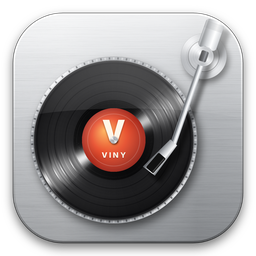
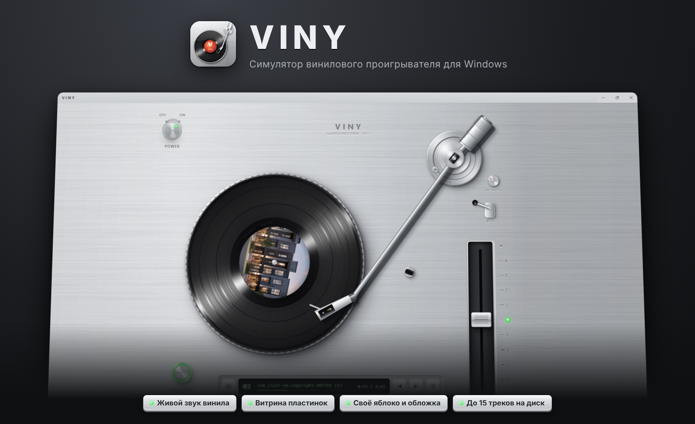

<div align="center">



# Viny

**Симулятор винилового проигрывателя для Windows**

Ставьте пластинки, опускайте иглу и слушайте свою музыку с тёплым звуком винила.


[**Скачать**](../../releases) · [Возможности](#-возможности) · [Управление](#-управление) · [Сборка](#-сборка-из-исходников)

<br>



</div>

<br>

## ✦ Возможности

<table>
<tr>
<td width="50%" valign="top">

### 🎛 Настоящий проигрыватель
- Ручка **POWER**, кнопка **START/STOP** с подсветкой
- **Тонарм** можно взять мышью и опустить в любое место пластинки
- Рычаг **CUE** для мягкого подъёма и опускания иглы
- **Питч** ±8% с центральной фиксацией и LED на нуле
- Автовозврат тонарма в конце стороны

</td>
<td width="50%" valign="top">

### 💿 Витрина пластинок
- Шкаф из ореха с пластинками на полках
- Создание своих дисков: название, исполнитель, 10 цветов винила
- **Яблоко**: своё изображение с круговым кадрированием
- **Обложка**: квадратное изображение или автоматический дизайн
- До **15 треков** на диск, drag & drop, смена порядка

</td>
</tr>
<tr>
<td width="50%" valign="top">

### 🔊 Звук винила
- Инерция мотора: разгон и торможение с плавающим тоном
- Wow & flutter, тёплая окраска и мягкая сатурация
- Потеря верхних частот ближе к центру пластинки
- Шипение, рокот, треск, щелчки и пылинка раз за оборот
- Звук опускания иглы, вводная канавка и замкнутая канавка в конце

</td>
<td width="50%" valign="top">

### ✨ Физический интерфейс
- Шлифованный алюминий и проточенный металл
- Блики на канавках, которые не вращаются вместе с диском
- Многослойные тени от одного источника света
- Серебристые кнопки со светодиодами и тумблеры
- Механические щелчки при каждом нажатии

</td>
</tr>
</table>

## ⬇ Установка

1. Откройте раздел [**Releases**](../../releases).
2. Скачайте один из файлов:
   - `Viny Setup 1.0.0.exe` - установщик с ярлыком на рабочем столе
   - `Viny-Portable-1.0.0.exe` - портативная версия, работает без установки
3. Запустите и нажмите на пластинку, чтобы открыть витрину.

> [!NOTE]
> Приложение не подписано цифровой подписью, поэтому Windows SmartScreen может показать предупреждение. Нажмите **Подробнее → Выполнить в любом случае**.

## 🎚 Управление

| Действие | Мышь | Клавиша |
| :-- | :-- | :-- |
| Питание | Ручка **POWER** | `P` |
| Старт / стоп диска | Кнопка **START/STOP** | `Пробел` |
| Поднять / опустить иглу | Рычаг **CUE** | `L` |
| Перемотка по пластинке | Перетащить тонарм | - |
| Предыдущий / следующий трек | Кнопки на панели | `←` `→` |
| Открыть витрину | Клик по пластинке | `D` |
| Сбросить питч | Двойной клик по ползунку | - |
| Закрыть окно | Кнопка **×** | `Esc` |

## 🛠 Сборка из исходников

Нужен [Node.js](https://nodejs.org) версии LTS.

```bash
git clone https://github.com/A01L/Viny.git
cd Viny
npm install
npm start          # запуск
npm run dist       # сборка установщика и portable exe в папку dist
```

На Windows можно просто дважды щёлкнуть `start.bat` или `build-exe.bat`.

> [!TIP]
> Если сборка падает с ошибкой `Cannot create symbolic link`, запустите её от имени администратора или включите **Режим разработчика** в параметрах Windows.

## 📁 Структура проекта

```
Viny/
├── main.js            # главный процесс Electron, хранение библиотеки, протокол viny://
├── preload.js         # безопасный мост между окном и системой
├── build/             # иконки приложения (png, ico)
├── docs/              # картинки для README
└── src/
    ├── index.html
    ├── styles.css     # физический интерфейс
    ├── deck.js        # проигрыватель: платтер, тонарм, мотор, управление
    ├── audio.js       # звуковой движок винила на Web Audio
    ├── vinyl.js       # рендер пластинки, раскладка треков по канавкам
    ├── metal.js       # процедурные материалы: алюминий, металл, дерево, блики
    ├── shelf.js       # витрина, карточка диска, редактор
    ├── cropper.js     # кадрирование изображений
    └── app.js         # запуск, настройки, горячие клавиши
```

## 💾 Где хранятся данные

Пластинки, треки и изображения копируются в папку пользователя:

```
%APPDATA%\Viny\library
```

Исходные файлы на диске не меняются, их можно удалять или переносить.

## 📄 Лицензия

Распространяется под лицензией [MIT](LICENSE).

<div align="center">
<br>

Сделано с любовью к винилу · [**Git: A01L**](https://github.com/A01L)

</div>
